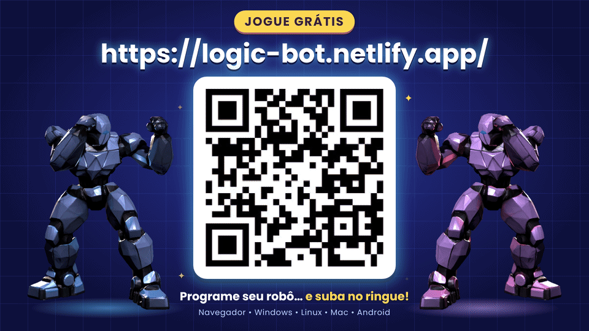

# LogicBot

Jogo educativo de luta de robôs: você programa o seu robô em Portugol e ele luta seguindo o seu código.

**Jogue grátis:** https://logic-bot.netlify.app/

## Arquivos

| Arquivo | O que é |
|---|---|
| [LogicBot_Como_Jogar.mp4](LogicBot_Como_Jogar.mp4) | Vídeo explicando como jogar (3min50, 1080p) |
| [LogicBot_Final_QR.png](LogicBot_Final_QR.png) | Tela final com link e QR code (imagem) |
| [LogicBot_Final_QR.gif](LogicBot_Final_QR.gif) | Tela final com link e QR code (animada) |

## Como baixar o vídeo

1. Clique em **LogicBot_Como_Jogar.mp4** na lista de arquivos acima.
2. Clique no botão de download (ícone de seta para baixo, à direita, ou "Download raw file").

Ou baixe tudo de uma vez: botão verde **Code** → **Download ZIP**.
